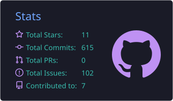
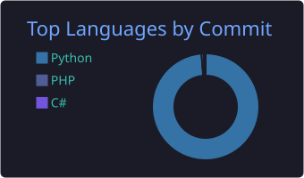
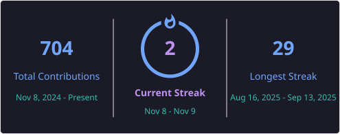

# 👋 Hi, I'm Amirhosein

### 💻 Python Developer | 📊 Data Analysis Enthusiast | 🌍 Lifelong Learner

I'm a programmer passionate about technology, problem-solving, and continuous learning.

I enjoy building projects, exploring data, and improving my programming skills. Currently, I'm focusing on ``Python``, ``Data Analysis``, and expanding my knowledge of software development.

---

## 🚀 About Me

- 💻 Interested in ``Data Analysis``, ``Programming`` and ``Computer Science``.
- 🐍 Mainly working with ``Python`` and its ecosystem.
- 🌍 Improving my ``English`` and exploring foreign languages.
- 📚 Always learning new technologies and developing practical projects.

---

## 🧠 Skills & Technologies

### 💻 Programming Languages

  
  
  
  

### 📊 Data Analysis & Libraries

  
  
  

### 🛠️ Frameworks & Tools

  
  
  
  
  
  

## 📊 GitHub Statistics

  
  

  

---

## 🌐 Languages

- 🇮🇷 Persian — Native
- 🇬🇧 English — Upper-Intermediate

---

## 🤝 Connect With Me

  
  
  

---

⭐ Learning by building, growing through experience.
